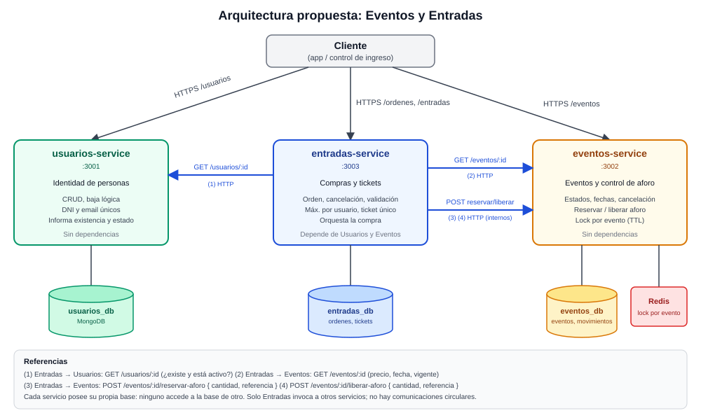
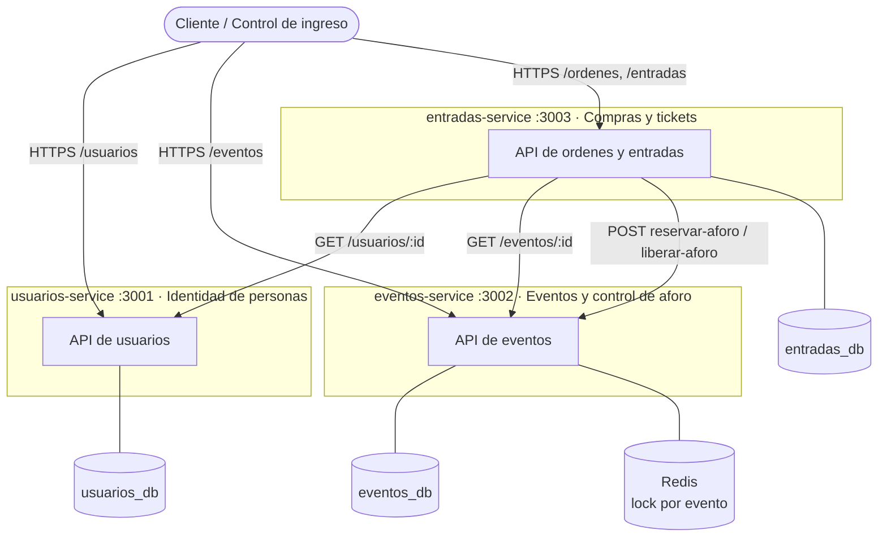

# Arquitectura propuesta: de API REST a Microservicios

**Materia:** Programación Distribuida · Licenciatura en Sistemas de Información
**Trabajo Práctico N° 5:** De API REST a Microservicios
**Fecha:** `16 de octubre 2026`
**Grupo:** `2`
**Integrantes:** `Bazan Franco, Gorri Juan, Le Donne Micaela,Molina Agostina,Nievas Milagros`

> **Dominio elegido:** Eventos y entradas. Usuarios registrados compran entradas para eventos con aforo limitado, reciben un ticket y lo presentan en el ingreso, donde se valida.

## Índice

1. [Punto de partida y alcance](#1-punto-de-partida-y-alcance)
2. [Análisis de la aplicación existente (inventario)](#2-análisis-de-la-aplicación-existente-inventario)
3. [Identificación de responsabilidades](#3-identificación-de-responsabilidades)
4. [Identificación de acoplamientos](#4-identificación-de-acoplamientos)
5. [Propuesta de microservicios](#5-propuesta-de-microservicios)
6. [Propiedad y acceso a los datos](#6-propiedad-y-acceso-a-los-datos)
7. [Comunicación entre microservicios](#7-comunicación-entre-microservicios)
8. [Trazado de casos de uso](#8-trazado-de-casos-de-uso)
9. [Diagrama de arquitectura](#9-diagrama-de-arquitectura)
10. [Validación de los límites propuestos (checklist)](#10-validación-de-los-límites-propuestos-checklist)

> La numeración de este documento es propia; entre paréntesis se indica a qué sección de la consigna del TP5 corresponde cada parte.

---

## 1. Punto de partida y alcance

La aplicación base es la API de **Usuarios** desarrollada en los trabajos anteriores:

| TP | Aporte a la aplicación |
|----|------------------------|
| TP1 | API REST con CRUD de usuarios (Node.js + Express), datos en memoria |
| TP2 | HTTPS con certificado autofirmado; recurso de reservas de cupo con condición de carrera y exclusión mutua mediante lock en Redis/Memurai (TTL 5 s) |
| TP3 | Persistencia en MongoDB con Mongoose, logging con Winston (rotación y retención), documentación OpenAPI/Swagger |
| TP4 | Cluster de 3 nodos con Raft educativo: elección de Leader, log replicado, State Machine sobre el CRUD, integración Redis + Raft |

**Alcance de este TP:** análisis y diseño. No se implementan los microservicios; se deja documentada y justificada la arquitectura para comenzar la migración del código en los trabajos siguientes.

---

## 2. Análisis de la aplicación existente (inventario)
*(Sección 5 de la consigna)*

### 2.1 Recursos y entidades principales

| Recurso / entidad | Campos | Origen |
|-------------------|--------|--------|
| **Usuario** | `id`, `dni`, `nombreApellido`, `fechaNacimiento`, `email`, `direccion` | TP1, persistido en MongoDB desde TP3 (DNI y email únicos) |
| **Recurso de reserva (cupo)** | `id`, `nombre`, `disponibles` | TP2, mantenido en memoria del proceso |
| **Entrada de log Raft** | posición, término, comando | TP4 |
| **Lock** | clave `lock:reserva:{id}` con TTL | TP2, almacenado en Redis/Memurai |

### 2.2 Inventario de funcionalidades y endpoints

| Funcionalidad / endpoint | Responsabilidad actual | Datos utilizados | Dependencias |
|--------------------------|------------------------|------------------|--------------|
| `GET /usuarios` | Listar todos los usuarios | Colección `usuarios` | MongoDB (Mongoose) |
| `GET /usuarios/:id` | Consultar un usuario; 400 si el id es inválido, 404 si no existe | Usuario | MongoDB, validación de id |
| `POST /usuarios` | Alta de usuario; valida los 5 campos obligatorios (400) y unicidad de DNI/email (409) | Usuario | MongoDB, esquema Mongoose, Raft (en TP4 la escritura pasa por el log) |
| `PUT /usuarios/:id` | Modificación parcial de un usuario; rechaza cuerpo vacío (400) | Usuario | MongoDB, Raft |
| `DELETE /usuarios/:id` | Baja de un usuario | Usuario | MongoDB, Raft |
| `GET /reservas` | Consultar el estado del recurso de reserva | Recurso de reserva (`disponibles`) | Memoria del proceso |
| `POST /reservas/reservar` | Descontar un cupo: toma el lock, verifica `disponibles > 0`, descuenta, libera el lock; 423 si el recurso está bloqueado, 409 si no hay cupos | Recurso de reserva | Redis/Memurai (lock con `NX` y TTL), Raft (TP4) |
| `GET /api-docs`, `GET /api-docs.json` | Documentación OpenAPI/Swagger de la API | Especificación OpenAPI | swagger-ui-express |
| Endpoints de diagnóstico del nodo y del log (TP4) | Mostrar identidad, rol, término, Leader conocido y log | Estado Raft | Módulo Raft |
| RPC internos Raft: solicitud de voto y AppendEntries (TP4) | Elección de Leader, heartbeats, replicación | Término, voto, log | HTTP entre nodos |
| Logging (transversal) | Registro INFO/WARN/ERROR con rotación y retención | Archivos `logs/` | Winston |
| HTTPS (transversal) | Cifrado de la API externa | Certificado y clave de desarrollo | Variables de entorno |

### 2.3 Reglas de negocio y validaciones existentes

- Usuario: `dni`, `nombreApellido`, `fechaNacimiento`, `email` y `direccion` son obligatorios.
- Usuario: `dni` y `email` deben ser únicos (409 ante duplicado).
- Usuario: el `id` debe tener formato válido (400) y existir (404).
- Reserva: no se descuenta un cupo si `disponibles <= 0` (409).
- Reserva: un solo proceso a la vez puede modificar un mismo recurso (lock por recurso; 423 si está ocupado).
- Reserva: el lock tiene TTL para no bloquear indefinidamente ante una falla.
- Raft: una escritura no se aplica hasta estar *committed* por mayoría; una escritura recibida por un follower no se aplica localmente.

### 2.4 Módulos, persistencia e información compartida

| Aspecto | Situación actual |
|---------|------------------|
| Módulos | `index.js` (arranque, HTTPS, conexión a Mongo y Redis, recurso y rutas de reservas, rutas de usuarios), `models/Usuario.js` (esquema), `utils/logger.js` (Winston), `src/routers/` |
| Persistencia | MongoDB para usuarios; memoria del proceso para el recurso de reserva; Redis solo para locks; persistencia propia del log Raft por nodo |
| Información compartida | El modelo de Usuario es usado por el CRUD y por la State Machine de Raft; el recurso de reserva y su lock se manejan dentro del mismo handler |

> **Dato a corregir en los datos de ejemplo:** el usuario 4 de `app-base/usuarios.json` tiene `fechaNacimiento: "2006-13-03"` (mes 13, inválido). Es un buen ejemplo de validación que debe pertenecer al servicio de Usuarios.

---

## 3. Identificación de responsabilidades
*(Sección 6 de la consigna)*

Las funcionalidades se agrupan por la responsabilidad funcional que cumplen, no por archivos ni controladores.

### Grupo A: Gestión de la identidad de las personas

| Pregunta | Respuesta |
|----------|-----------|
| 1. ¿Qué problema resuelve? | Saber quiénes son las personas que usan el sistema y mantener sus datos personales sin duplicados. |
| 2. ¿Qué operaciones realiza? | Alta, consulta, modificación y baja de usuarios. |
| 3. ¿Qué reglas contiene? | Campos obligatorios, unicidad de DNI y email, fecha de nacimiento válida. |
| 4. ¿Qué información necesita? | Solo los datos de la persona. |
| 5. ¿Qué crea o modifica? | Perfil de usuario. |
| 6. ¿Qué otras funcionalidades necesita conocer? | Ninguna. |
| 7. ¿Qué cambios suelen ocurrir juntos? | Nuevos datos del perfil y sus validaciones (por ejemplo, estado activo/inactivo). |
| 8. ¿Podría evolucionar independiente? | **Sí.** Es la parte más autónoma de la aplicación. |

### Grupo B: Venta de lugares sobre un recurso con capacidad limitada
*(hoy llamado "reserva de cupo")*

| Pregunta | Respuesta |
|----------|-----------|
| 1. ¿Qué problema resuelve? | Evitar que se entreguen más lugares que la capacidad disponible, aun con pedidos simultáneos. |
| 2. ¿Qué operaciones realiza? | Consultar disponibilidad y descontar un lugar. |
| 3. ¿Qué reglas contiene? | No hay venta sin disponibilidad; exclusión mutua por recurso; TTL del lock. |
| 4. ¿Qué información necesita? | Recurso (nombre, disponibles) y el lock en Redis. |
| 5. ¿Qué crea o modifica? | El contador `disponibles`. |
| 6. ¿Qué otras funcionalidades necesita conocer? | Hoy ninguna, pero **no sabe quién reserva ni para qué evento**. |
| 7. ¿Qué cambios suelen ocurrir juntos? | Reglas de capacidad (aforo, overbooking, estados del recurso) cambian juntas. En cambio, las reglas de "quién puede comprar y cuántas veces" cambian por otro motivo. |
| 8. ¿Podría evolucionar independiente? | **Parcialmente.** Mezcla dos responsabilidades: controlar la capacidad del recurso y registrar la operación de cada persona. Conviene separarlas. |

### Grupo C: Consenso y replicación del estado

| Pregunta | Respuesta |
|----------|-----------|
| 1. ¿Qué problema resuelve? | Que varias réplicas acuerden un orden único de operaciones y toleren la caída de un nodo. |
| 2. ¿Qué operaciones realiza? | Elección de Leader, heartbeats, replicación del log, commit, aplicación en la State Machine. |
| 3. ¿Qué reglas contiene? | Quórum por mayoría, un voto por término, commit solo con mayoría. |
| 4. ¿Qué información necesita? | Término, voto, log, lista de peers. |
| 5. ¿Qué crea o modifica? | Log replicado y estado confirmado. |
| 6. ¿Qué otras funcionalidades necesita conocer? | Hoy aplica comandos directamente sobre el modelo de Usuario. |
| 7. ¿Qué cambios suelen ocurrir juntos? | Protocolo y State Machine. |
| 8. ¿Podría evolucionar independiente? | **Sí, como mecanismo.** No es una responsabilidad de negocio: es una técnica de replicación que se aplica a algún servicio, no un servicio de negocio. |

### Grupo D: Servicios transversales (seguridad, logs, documentación)

| Pregunta | Respuesta |
|----------|-----------|
| 1. ¿Qué problema resuelve? | Seguridad del transporte, trazabilidad y documentación de la API. |
| 2. ¿Qué operaciones realiza? | Cifrado HTTPS, registro de eventos con rotación, publicación de Swagger. |
| 3. ¿Qué reglas contiene? | No registrar secretos; niveles INFO/WARN/ERROR; retención limitada. |
| 4. ¿Qué información necesita? | Certificado, configuración de entorno, especificación OpenAPI. |
| 5. ¿Qué crea o modifica? | Archivos de log. |
| 6. ¿Qué otras funcionalidades necesita conocer? | Todas (las atraviesa). |
| 7. ¿Qué cambios suelen ocurrir juntos? | Formato de logs y su configuración; documentación de cada endpoint cuando este cambia. |
| 8. ¿Podría evolucionar independiente? | Es **infraestructura compartida**: cada servicio la incorpora, no se convierte en un servicio propio. |

### Conclusión del análisis

| Grupo actual | Destino en la arquitectura propuesta |
|--------------|--------------------------------------|
| A: Identidad de personas | **Servicio Usuarios** |
| B: Venta de lugares | Se **divide**: control de capacidad en el **servicio Eventos**; compra y ticket de cada persona en el **servicio Entradas** |
| C: Consenso y replicación | No es un servicio; se conserva como mecanismo a aplicar sobre el servicio que requiera consistencia fuerte (candidato: Eventos) |
| D: Transversales | Cada servicio incorpora HTTPS, Winston y Swagger |

---

## 4. Identificación de acoplamientos
*(Sección 7 de la consigna)*

| Caso | Acoplamiento detectado | Problema generado | Propuesta de desacople |
|------|------------------------|-------------------|------------------------|
| **1** | **Aplicación monolítica en `index.js`:** el mismo archivo arranca el servidor HTTPS, conecta a MongoDB y a Redis, declara el recurso de reservas y monta las rutas de usuarios y de reservas. Existe porque se fue agregando funcionalidad sobre el proyecto del TP1. | Un cambio en reservas obliga a redesplegar y reprobar también usuarios; una falla de Redis o del recurso afecta el arranque de toda la aplicación; no se puede escalar una parte sin la otra. | Un proceso por responsabilidad (Usuarios, Eventos, Entradas), cada uno con su configuración y su base. |
| **2** | **Regla de negocio, lock y respuesta HTTP en el mismo handler de `POST /reservas/reservar`:** la decisión "no hay cupos", la coordinación con Redis y el armado de la respuesta están mezcladas. Existe porque la protección contra la condición de carrera se agregó dentro del handler del TP2. | La regla de capacidad no se puede reutilizar ni probar sin HTTP y Redis; cualquier nuevo caso que consuma lugares (cancelar, vender varios) duplica la lógica. | Concentrar la capacidad y el lock en un único servicio (**Eventos**), con operaciones internas `reservar-aforo` y `liberar-aforo`. Quien quiera consumir lugares lo pide por API. |
| **3** | **State Machine de Raft aplicando comandos directamente sobre el modelo de Usuario (Mongoose):** el protocolo de consenso conoce el esquema del negocio. Existe porque en el TP4 se integró el CRUD existente al log. | Agregar un recurso nuevo exige modificar el módulo de consenso; no se puede cambiar el modelo sin tocar la replicación. | Que el consenso sea un mecanismo genérico (comandos opacos) y que cada servicio aporte su propia State Machine. Raft no se publica como servicio de negocio. |
| **4** | **Recurso de reserva sin dueño ni contexto:** el cupo no sabe qué evento representa ni quién lo reservó; la operación de la persona y el contador viven juntos. Existe porque el TP2 tenía un único recurso de demostración. | No se puede saber quién tiene lugar, ni impedir que una persona tome muchos lugares, ni cancelar correctamente; cualquier regla de "por persona" obliga a modificar el contador. | Separar **capacidad del evento** (Eventos) de **orden y ticket de la persona** (Entradas). Entradas guarda el `usuarioId` y valida al usuario consultando a Usuarios. |
| **5** | **Información de usuario compartida implícitamente:** si cualquier otro módulo necesita saber si un usuario existe, hoy lo resolvería leyendo la misma colección. | Acceso directo a datos ajenos: un cambio en el esquema rompe a los consumidores. | Consultar al servicio Usuarios por su API pública (`GET /usuarios/:id`) y usar solo `id` y `activo`. |

---

## 5. Propuesta de microservicios
*(Sección 8 de la consigna)*

Se proponen **tres servicios de negocio**, cada uno con una responsabilidad distinta, sus propios datos y una interfaz pública. No se crea un servicio por entidad: **Eventos** concentra las reglas de capacidad, y **Entradas** concentra el ciclo de vida de la compra y del ticket de cada persona.

### 5.1 Fichas de definición

#### Servicio 1: `usuarios-service`

| Elemento | Definición |
|----------|------------|
| **Nombre** | `usuarios-service` |
| **Responsabilidad principal** | Mantener la identidad y los datos personales de las personas registradas. |
| **Operaciones** | Alta, consulta individual, listado, modificación y baja de usuarios; informar si un usuario existe y está activo. |
| **Reglas de negocio** | Campos obligatorios (`dni`, `nombreApellido`, `fechaNacimiento`, `email`, `direccion`); `dni` y `email` únicos (409); fecha de nacimiento con formato y calendario válidos; la baja es **lógica** (`activo = false`) para no dejar entradas de otros servicios apuntando a un usuario inexistente. |
| **Datos propios** | `usuarios`: `id`, `dni`, `nombreApellido`, `fechaNacimiento`, `email`, `direccion`, `activo` (campo nuevo). |
| **Endpoints** | **Migran del servicio actual:** `GET /usuarios`, `GET /usuarios/:id`, `POST /usuarios`, `PUT /usuarios/:id`, `DELETE /usuarios/:id` (pasa a baja lógica). **Nuevos:** `GET /health`. |
| **Dependencias** | Ninguna. No invoca a otros servicios. |
| **Fuera de alcance** | Qué entradas compró cada usuario; eventos; autenticación y contraseñas (no existen hoy en la aplicación). |
| **Justificación** | Es el grupo A del análisis: la parte más autónoma. Sus reglas (unicidad, validación de datos personales) cambian por motivos propios y no dependen de ningún otro dato. Al convertirse en la única autoridad sobre la identidad, los demás servicios dejan de leer su colección. |

#### Servicio 2: `eventos-service`

| Elemento | Definición |
|----------|------------|
| **Nombre** | `eventos-service` |
| **Responsabilidad principal** | Gestionar los eventos y garantizar que nunca se entreguen más lugares que su aforo. |
| **Operaciones** | Crear, consultar, modificar y cancelar eventos; reservar aforo; liberar aforo; informar disponibilidad y vigencia. |
| **Reglas de negocio** | Estados `PUBLICADO`, `AGOTADO`, `CANCELADO`, `FINALIZADO`. No se reserva aforo si el evento no está `PUBLICADO` o ya pasó. `0 ≤ disponibles ≤ aforoTotal`. Al llegar a 0 pasa a `AGOTADO`; al liberar vuelve a `PUBLICADO`. El aforo total no puede bajar de lo ya vendido. Exclusión mutua **por evento** con lock en Redis y TTL. Reservar y liberar son **idempotentes** por `referencia`. |
| **Datos propios** | `eventos`: `id`, `nombre`, `fecha`, `lugar`, `precio`, `aforoTotal`, `disponibles`, `estado`. `movimientosAforo`: `referencia`, `tipo` (reserva/liberación), `cantidad` (para la idempotencia). Claves de lock `lock:evento:{id}` en Redis. |
| **Endpoints** | **Migran del servicio actual:** `GET /reservas` → `GET /eventos` y `GET /eventos/:id`; `POST /reservas/reservar` → `POST /eventos/:id/reservar-aforo` (lógica de lock y descuento). **Nuevos:** `POST /eventos`, `PUT /eventos/:id`, `PATCH /eventos/:id/cancelar`, `POST /eventos/:id/liberar-aforo` (interno), `GET /health`. |
| **Dependencias** | Ninguna. No invoca a otros servicios (usa Redis como infraestructura propia). |
| **Fuera de alcance** | Quién compró; tickets; órdenes; precio histórico de una compra; reembolsos; datos del usuario. |
| **Justificación** | Es el dueño de la regla de capacidad (grupo B). Concentrar ahí el contador y su lock deja **una sola autoridad** sobre la disponibilidad, con la sección crítica del TP2 en un único lugar. Tiene reglas propias (estados, fechas, cancelación del evento) por lo que no es un simple contador. |

#### Servicio 3: `entradas-service`

| Elemento | Definición |
|----------|------------|
| **Nombre** | `entradas-service` |
| **Responsabilidad principal** | Gestionar la compra de entradas de cada usuario y el ciclo de vida de cada ticket. |
| **Operaciones** | Crear orden de compra, consultar orden, cancelar orden, listar entradas de un usuario, validar un ticket en el ingreso. |
| **Reglas de negocio** | Máximo de N entradas por usuario por evento (configurable, por defecto 4). Solo compran usuarios activos. Estados de orden `PENDIENTE`, `CONFIRMADA`, `CANCELADA`, `RECHAZADA`; estados de ticket `VALIDO`, `USADO`. Ticket de **uso único** mediante actualización condicional `VALIDO → USADO`. Cancelación permitida hasta cierto plazo antes del evento (por defecto 24 h). El `ordenId` es la clave de idempotencia. El `precioUnitario` se **congela** al comprar. |
| **Datos propios** | `ordenes`: `id`, `usuarioId`, `eventoId`, `cantidad`, `precioUnitario`, `estado`, `fechaCreacion`. `tickets`: `codigo` (único), `ordenId`, `estado`. |
| **Endpoints** | **Nuevos:** `POST /ordenes`, `GET /ordenes/:id`, `DELETE /ordenes/:id` (cancelar), `GET /entradas?usuarioId=`, `POST /entradas/validar`, `GET /health`. **Cambio de contrato:** la operación de "reservar" que hoy el cliente pide a `POST /reservas/reservar` pasa a ser `POST /ordenes`; el cliente ya no habla con el contador de aforo. |
| **Dependencias** | `usuarios-service` (`GET /usuarios/:id`); `eventos-service` (`GET /eventos/:id`, `POST /eventos/:id/reservar-aforo`, `POST /eventos/:id/liberar-aforo`). |
| **Fuera de alcance** | Contar el aforo y decidir si el evento admite venta (de Eventos); datos personales (de Usuarios); cobro real y reembolsos. |
| **Justificación** | Resuelve la carencia del grupo B: separa **la capacidad** (que es del evento) de **la operación de cada persona**. Sus reglas (máximo por usuario, uso único, plazo de cancelación) cambian por motivos de política de venta, sin tocar la capacidad. Guardar `usuarioId` y `precioUnitario` propios evita copiar el perfil del usuario y protege el histórico si el precio del evento cambia. |

### 5.2 Tabla general de responsabilidades

*(Sección 8.2 de la consigna)*

| Microservicio | Responsabilidad | Datos administrados | Funciones principales | Dependencias |
|---------------|-----------------|---------------------|-----------------------|--------------|
| `usuarios-service` | Identidad y datos personales | `usuarios` | CRUD de usuarios, baja lógica, informar existencia y estado | Ninguna |
| `eventos-service` | Eventos y control de aforo | `eventos`, `movimientosAforo`, locks en Redis | Gestión de eventos, reservar y liberar aforo, cancelar evento | Ninguna |
| `entradas-service` | Compra y tickets | `ordenes`, `tickets` | Comprar, cancelar, listar, validar ticket | `usuarios-service`, `eventos-service` |

---

## 6. Propiedad y acceso a los datos
*(Sección 9 de la consigna)*

| Dato / recurso | Servicio propietario | Quién puede consultarlo | Quién puede modificarlo | Forma de acceso |
|----------------|----------------------|-------------------------|-------------------------|-----------------|
| Perfil de usuario | `usuarios-service` | Cliente; `entradas-service` (solo existencia y estado) | Solo `usuarios-service` | API REST `GET /usuarios/:id` |
| Estado activo/inactivo del usuario | `usuarios-service` | `entradas-service` | Solo `usuarios-service` (baja lógica) | API REST `GET /usuarios/:id` |
| Datos del evento (nombre, fecha, lugar, precio) | `eventos-service` | Cliente; `entradas-service` | Solo `eventos-service` | API REST `GET /eventos/:id` |
| Estado y vigencia del evento | `eventos-service` | Cliente; `entradas-service` | Solo `eventos-service` | API REST `GET /eventos/:id` (campo `vigente`) |
| Aforo disponible | `eventos-service` | Cliente; `entradas-service` | Solo `eventos-service`, ante pedido de `entradas-service` | Lectura por `GET /eventos/:id`; escritura mediante `POST /eventos/:id/reservar-aforo` y `liberar-aforo` |
| Movimientos de aforo (idempotencia) | `eventos-service` | Solo `eventos-service` | Solo `eventos-service` | Interno |
| Lock de aforo (Redis) | `eventos-service` | Solo `eventos-service` | Solo `eventos-service` | Interno (claves `lock:evento:{id}`) |
| Orden de compra | `entradas-service` | Cliente | Solo `entradas-service` | API REST `GET /ordenes/:id` |
| Ticket | `entradas-service` | Cliente; control de ingreso | Solo `entradas-service` | `POST /entradas/validar`, `GET /entradas?usuarioId=` |
| Precio histórico de una orden | `entradas-service` | Cliente | Solo `entradas-service` (se fija al crear) | `GET /ordenes/:id` |

> **Regla de diseño aplicada:** ningún servicio modifica datos de otro ni accede a su base. Cada servicio usa su **propia base** (`usuarios_db`, `eventos_db`, `entradas_db`). Redis lo usa únicamente `eventos-service` y sus claves no se comparten.

---

## 7. Comunicación entre microservicios
*(Sección 10 de la consigna)*

Las comunicaciones son HTTP/REST. Solo `entradas-service` invoca a otros servicios; **Usuarios y Eventos no se invocan entre sí ni invocan a Entradas**.

### 7.1 Matriz de comunicaciones

| # | Origen | Destino | Necesidad | Método / endpoint | Datos intercambiados | Respuesta esperada |
|---|--------|---------|-----------|-------------------|----------------------|--------------------|
| 1 | `entradas-service` | `usuarios-service` | Verificar que el comprador existe y está activo | `GET /usuarios/:id` | Envía `usuarioId` en la ruta | `200` con el usuario (se usan `id` y `activo`); `404` si no existe |
| 2 | `entradas-service` | `eventos-service` | Obtener precio, fecha y vigencia del evento | `GET /eventos/:id` | Envía `eventoId` | `200` con `nombre`, `fecha`, `precio`, `vigente`, `disponibles`; `404` si no existe |
| 3 | `entradas-service` | `eventos-service` | Reservar lugares del aforo | `POST /eventos/:id/reservar-aforo` | Envía `{ cantidad, referencia: ordenId }` | `200` con `{ reservado: true, disponibles }`; `409` sin aforo o evento no vendible; `423` lock ocupado (reintentar) |
| 4 | `entradas-service` | `eventos-service` | Devolver lugares al cancelar o compensar | `POST /eventos/:id/liberar-aforo` | Envía `{ cantidad, referencia: ordenId }` | `200` con `{ liberado: true, disponibles }`; repetir con la misma referencia no vuelve a sumar |

La validación de un ticket en el ingreso reutiliza la comunicación **#2** (consulta de `vigente`).

> Los endpoints `reservar-aforo` y `liberar-aforo` son **internos**: están documentados en el contrato de `eventos-service`, pero no están pensados para que los use el cliente final.

### 7.2 Análisis de cada comunicación

| Comunicación | ¿Es necesario que conozca al otro? | ¿Duplica una regla con un único propietario? | ¿La información podría pertenecer a quien la pide? | ¿El contrato oculta detalles internos? | Si el destino no está disponible |
|--------------|-----------------------------------|----------------------------------------------|----------------------------------------------------|---------------------------------------|----------------------------------|
| #1 Entradas → Usuarios | Sí: no debe vender a quien no existe o está inactivo. | No: la regla de "usuario activo" sigue siendo de Usuarios; Entradas solo la consulta. | No: copiar el perfil duplicaría datos que pueden cambiar. | Sí: se usa la API pública, no su colección. | Entradas responde `503` y la orden queda `RECHAZADA`. No se descuenta aforo. |
| #2 Entradas → Eventos (consulta) | Sí: necesita precio y fecha para crear la orden y calcular el plazo de cancelación. | No: la decisión de si el evento admite ventas o ingreso la toma Eventos (campo `vigente`). | El precio se **copia al momento de comprar** a propósito, como dato histórico propio de la orden. | Sí. | Al comprar: `503`, orden `RECHAZADA`. Al validar un ticket: se rechaza el ingreso con `503` (decisión conservadora). |
| #3 Entradas → Eventos (reservar) | Sí: solo Eventos puede modificar el aforo. | No: la regla de capacidad vive únicamente en Eventos. | No: el aforo es del evento. | Sí: se pide una acción (`cantidad`), no se accede a la base ni al lock. | Entradas responde `503`; la orden queda `PENDIENTE` o `RECHAZADA`. Como el pedido es idempotente, un reintento no duplica el descuento. |
| #4 Entradas → Eventos (liberar) | Sí: para cancelar o compensar. | No. | No. | Sí. | La cancelación queda pendiente de reintento. Es idempotente por `referencia`. |

### 7.3 Comunicaciones que se decidió **no** crear

- **Eventos → Entradas** (para avisar la cancelación de un evento): crearía dependencia circular. En su lugar, Entradas consulta `vigente` al validar el ticket.
- **Usuarios → Entradas** (para avisar una baja): Entradas consulta a Usuarios al comprar; las entradas ya vendidas a un usuario dado de baja lógica siguen siendo válidas.
- **Usuarios ↔ Eventos:** no existe necesidad de negocio.

---

## 8. Trazado de casos de uso
*(Sección 10.1 de la consigna)*

### 8.1 Caso de uso 1: Comprar entradas

```
Cliente
  │  POST /ordenes { usuarioId, eventoId, cantidad }
  ▼
entradas-service ── crea orden PENDIENTE (ordenId = clave de idempotencia)
  │
  ├── HTTP GET /usuarios/:id ───────────► usuarios-service      (existe y está activo)
  ├── HTTP GET /eventos/:id ────────────► eventos-service       (precio, fecha, vigente)
  │
  ├── verifica su regla propia: máximo N entradas por usuario y evento
  │
  ├── HTTP POST /eventos/:id/reservar-aforo { cantidad, referencia = ordenId }
  │        ▼
  │   eventos-service ── toma lock Redis lock:evento:{id}
  │                   ── verifica evento PUBLICADO y disponibles ≥ cantidad
  │                   ── descuenta, registra movimiento, libera lock
  │        ▲  200 { reservado, disponibles }   |   409 sin aforo   |   423 lock ocupado
  │
  ├── genera tickets y pasa la orden a CONFIRMADA   (o RECHAZADA si hubo 409)
  ▼
Respuesta al cliente: 201 con la orden y sus tickets   |   409 sin lugares   |   503 servicio no disponible
```

| Aspecto | Detalle |
|---------|---------|
| **Quién inicia** | El cliente, hacia `entradas-service`. |
| **Quién decide qué** | Usuarios decide si el usuario existe y está activo. Eventos decide si el evento admite venta y si hay aforo. Entradas decide el máximo por persona. |
| **Qué datos se consultan** | Usuario (existencia y estado), evento (precio, fecha, vigencia). |
| **Quién modifica el estado** | Eventos modifica `disponibles`. Entradas modifica `ordenes` y `tickets`. Usuarios no modifica nada. |
| **Si algo falla en el medio** | Si Eventos descontó pero Entradas se cayó, la orden queda `PENDIENTE`: un proceso de reintento vuelve a pedir `reservar-aforo` (idempotente) o `liberar-aforo` para compensar. Nunca se descuenta dos veces la misma `referencia`. |

### 8.2 Caso de uso 2: Validar una entrada en el ingreso

```
Control de ingreso (cliente)
  │  POST /entradas/validar { codigo }
  ▼
entradas-service ── busca el ticket por código
  │
  ├── HTTP GET /eventos/:id ──► eventos-service     (¿vigente?)
  │
  ├── actualización condicional atómica: estado VALIDO → USADO
  │        (si dos personas escanean el mismo código a la vez, solo una pasa)
  ▼
Respuesta: 200 ingreso permitido   |   409 ticket ya usado   |   404 código inexistente   |   422 evento no vigente
```

| Aspecto | Detalle |
|---------|---------|
| **Quién inicia** | El control de ingreso, hacia `entradas-service`. |
| **Quién decide qué** | Eventos decide si el evento está vigente (campo `vigente`). Entradas decide si el ticket es válido y de uso único. |
| **Qué datos se consultan** | Ticket (propio de Entradas) y vigencia del evento. |
| **Quién modifica el estado** | Solo Entradas (pasa el ticket a `USADO`). |
| **Si Eventos no responde** | Se rechaza el ingreso con `503`. Se eligió esa conducta conservadora para no admitir entradas de un evento posiblemente cancelado. |

### 8.3 Caso de uso adicional: Cancelar una orden

```
Cliente ── DELETE /ordenes/:id ──► entradas-service
   ├── verifica estado CONFIRMADA y plazo (fecha del evento − PLAZO_CANCELACION_HORAS)
   ├── HTTP POST /eventos/:id/liberar-aforo { cantidad, referencia = ordenId } ──► eventos-service
   └── orden → CANCELADA, tickets → anulados
```

---

## 9. Diagrama de arquitectura
*(Sección 11 de la consigna)*



Versión editable (se renderiza automáticamente en GitHub):



**Qué muestra el diagrama:**

- Los **tres microservicios** con su responsabilidad general.
- Los **puntos de entrada del cliente**: el cliente se conecta a cada servicio por sus rutas públicas. Se decidió no introducir un API Gateway en esta etapa para no sumar un componente que no resuelve una responsabilidad de negocio; queda como evolución posible.
- Las **comunicaciones y su sentido**: todas parten de `entradas-service`; ninguna es circular.
- La **persistencia** de cada servicio: una base independiente por servicio y Redis usado solo por Eventos.

---

## 10. Validación de los límites propuestos (checklist)
*(Sección 12 de la consigna)*

| Criterio | `usuarios-service` | `eventos-service` | `entradas-service` |
|----------|--------------------|-------------------|--------------------|
| Su responsabilidad principal se explica en una frase clara | ✅ Mantener la identidad de las personas | ✅ Controlar eventos y que nunca se supere el aforo | ✅ Gestionar la compra y el ticket de cada persona |
| Agrupa reglas de negocio relacionadas entre sí | ✅ Unicidad y validez de datos personales | ✅ Estados, fechas y capacidad | ✅ Máximo por persona, uso único, plazo de cancelación |
| Posee datos o decisiones de las que es responsable | ✅ `usuarios` | ✅ `eventos`, aforo, locks | ✅ `ordenes`, `tickets` |
| No fue creado solo porque existe una tabla, entidad o controlador | ✅ Es una responsabilidad de identidad, con reglas propias | ✅ Contiene reglas y lock, no solo un CRUD de eventos | ✅ Agrupa dos entidades (orden y ticket) por su ciclo de vida común |
| Su interfaz pública se define sin exponer detalles internos | ✅ | ✅ El lock y los movimientos no se exponen | ✅ |
| Puede modificarse internamente sin cambios simultáneos en los demás | ✅ | ✅ Mientras se mantengan los contratos `reservar-aforo`/`liberar-aforo` | ✅ |
| No duplica reglas cuya autoridad es de otro servicio | ✅ | ✅ | ✅ Consulta `vigente` y `activo`, no los recalcula |
| Sus dependencias son necesarias y están justificadas | ✅ No tiene | ✅ No tiene | ✅ Usuarios (comprador válido) y Eventos (aforo y datos), justificado en 7.2 |
| Se pueden explicar las responsabilidades que quedan fuera | ✅ | ✅ | ✅ |

### Señales de alerta revisadas

- **¿Comparten continuamente datos internos?** No: cada servicio tiene su base y solo se hablan por API.
- **¿Modifican las mismas entidades?** No: cada dato tiene un único propietario (sección 6).
- **¿Coordinan casi todas sus operaciones?** `entradas-service` necesita a los otros dos para **comprar**, pero no para validar un ticket (solo consulta `vigente`) ni para listar sus órdenes. Usuarios y Eventos son totalmente independientes entre sí. El riesgo de que Entradas dependa demasiado de Eventos se mitiga porque las reglas de capacidad (Eventos) y de política de venta (Entradas) cambian por motivos distintos.

### Decisiones descartadas

| Alternativa | Motivo del descarte |
|-------------|---------------------|
| Un servicio por entidad (usuario, evento, orden, ticket) | Generaría comunicaciones constantes sin ganar cohesión; orden y ticket comparten ciclo de vida. |
| `raft-service`, `logging-service`, `swagger-service` | Son mecanismos técnicos transversales, no responsabilidades de negocio. |
| Servicio de Pagos o de Notificaciones | No son necesarios para el alcance actual; se pueden agregar en TPs posteriores si el enunciado lo requiere. |
| API Gateway | No resuelve una responsabilidad de negocio en esta etapa. |
| Eventos notificando a Entradas la cancelación | Introduciría dependencia circular. |

### Supuestos y limitaciones conocidas

- Se agrega el campo `activo` a Usuarios y la baja pasa a ser lógica (decisión nueva, no existe en la app base).
- Los valores `MAX_ENTRADAS_POR_USUARIO=4` y `PLAZO_CANCELACION_HORAS=24` son propuestas configurables.
- No se modela el cobro real ni los reembolsos de eventos cancelados.
- Las compras simultáneas de un mismo usuario para un mismo evento podrían superar el máximo si no se serializan por (usuario, evento); queda como mejora para la implementación.
- La conservación de Raft sobre algún servicio (candidato: Eventos) se decide en los trabajos de implementación.
