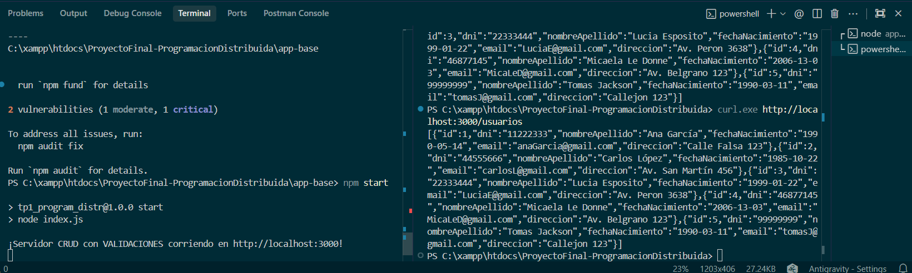
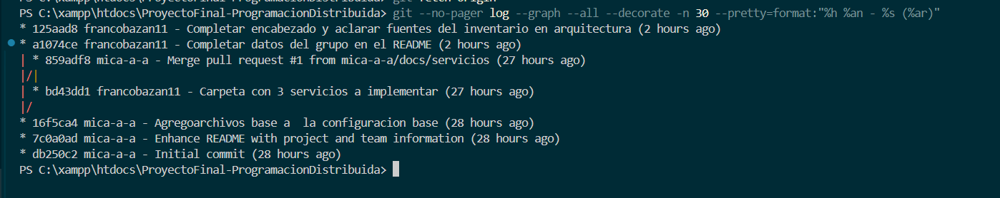

# Evidencias

Guardar en esta carpeta las capturas que respaldan los entregables del TP5.

| Ítem | Evidencia a incluir | Archivo sugerido |
|------|---------------------|------------------|
| 2 | Cada integrante con su identidad configurada (`git config --list`) | `01-git-config-<apellido>.png` |
| 3 | Settings → Collaborators con los dos docentes agregados | `02-colaboradores-docentes.png` |
| 4 | La app base instalada y respondiendo (`npm install`, `npm start`, `curl /usuarios`) | `03-app-base-funcionando.png` |
| 5 | `.gitignore` y `.env.example` en el repositorio | `04-gitignore-env-example.png` |
| 6 | Listado de ramas y commits con distintos autores | `05-ramas-y-commits.png` |
| 6 | Al menos un Pull Request integrado (descripción y revisión) | `06-pull-request.png` |
| — | Tag de entrega publicado (`tp5-entrega`) | `07-tag-tp5-entrega.png` |

## Capturas

### Identidad de Git de cada integrante

### Docentes agregados como colaboradores

### Versión base funcionando

### .gitignore y variables de ejemplo

### Ramas y commits

### Pull Request integrado
